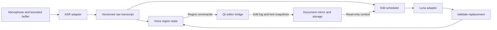

# Batscribe MVP implementation handoff

Status: MVP implemented (steps 1–4) on the `mvp` branch; see
[Implementation status](#implementation-status). Not yet validated against the live Deepgram and
OpenAI services. This document defines MVP requirements. [decisions.md](decisions.md) records
rationale, research and implementation notes; [future.md](future.md) contains deferred work, not
MVP acceptance requirements.

## Goal and scope

Build an in-app dictation editor that displays speech as it arrives and revises recent text
for explicit spoken corrections. Keep structured processing history for inspection.

- Target only the current **Linux / Fedora 44 / Wayland** system for MVP. No other OS,
  distribution, X11, packaging matrix, or portability layer is required. Preserve future
  compatibility where it costs no meaningful implementation time.
- Rust core, Qt Quick/QML UI through CXX-Qt, with a Qt-free core crate and a thin desktop crate.
- One speaker, English, plain-text documents; transcription stays inside this application.
- Deepgram Nova-3 streaming ASR and GPT-6 Luna text editing, independently replaceable
  through separate Rust interfaces. Only these adapters are required for MVP.
- Direct provider connections using user-supplied keys in Secret Service or session memory.
  No application server or embedded developer credentials.
- SQLite stores documents and diagnostic history. Audio retention is optional, streamed to
  one file per recording in a user-selected directory.

## First implementation steps — the MVP

1. **Editor foundation.** Binding a plain `TextArea` through its `text` property can't do what
   this editor needs. Build the editor bridge described under
   [Editor ownership, voice region, and undo](#editor-ownership-voice-region-and-undo): range
   edits, change notifications, shading, a read-only voice region, a voice caret, and
   user-only undo. Drive it with a scripted fake voice feed while typing; no audio or network.
   Verify input methods, selection/scroll preservation, blocked edits, undo, and Unicode
   positions. If a read-only region inside the editor proves unreliable, use the fallback in
   that section and record the outcome in decisions.md.
2. **Persistent editor and inspector.** Establish documents, recordings, events, edit logs,
   and settings snapshots in SQLite. Build the three-pane Qt shell, document loading, document
   saving, and paged history inspection. Verify deterministic replay of scripted voice and
   human edits, and reopening without network calls.
3. **Live recognition.** Add microphone/device selection, streaming ASR, optional audio
   files, Start/Stop and finalization. Persist and inspect the complete structured exchange.
   Verify provisional/final replacement, recording-relative audio spans, missing audio,
   bounded buffers, disconnect behavior, and interrupted-recording recovery.
4. **Live composition.** Add bounded Luna editing with request scheduling, revision checks,
   and region ownership. Keep readable ASR text when editing fails. Verify spoken
   corrections, `defer` handling, simultaneous typing, stale responses, and an end-to-end
   dictation session on the target system.

These four steps include the correctness checks needed for their features. Broader stress
testing, provider comparisons, tuning campaigns, and local recognition are deferred to
[future.md](future.md); they do not add further MVP milestones.

## UI and recording lifecycle

Use resizable panes: documents on the left, editor in the middle, details on the right.
The editor shows microphone level, Start/Stop, recording/finishing status, provisional text,
and visually distinct user and voice carets. The details pane can collapse.

Only one recording is active application-wide. Start creates a recording and a voice region
for the selected document. Default voice placement is the end of the user's current
**logical line**, not a visually wrapped line; an empty line starts at its beginning. A
selection uses its active end to choose the line and is not replaced. Preserve existing text,
insert appropriate spacing, and make only newly dictated text eligible for automatic
rewriting. Exact-caret placement is a preference. Start/Stop buttons must preserve the
editor caret position.

All voice additions and revisions happen inside the voice region, and new speech arrives at
the voice caret at its end. Moving the user caret never redirects recording. Initially the
user caret follows dictation, sitting just after the voice region and moving with it.

Explicit navigation, selection, or typing detaches the user caret. Subsequent typing and
voice input operate independently. Programmatic position adjustments do not detach it.
Scrolling away suspends auto-scroll without moving the voice caret. “Follow dictation”
rejoins tracking; each Start resets following. Switching documents leaves the recording
bound to its original document; show a persistent indicator with Stop and jump-back actions.

Stop immediately stops capture and hides the voice caret. Keep the voice region while
flushing audio, requesting ASR finalization, draining results, and performing the last edit.
Show “Finishing”; disable Start until completion or timeout, then release the region as
ordinary text. On timeout, retain available text and mark incomplete processing. The next
Start derives a new region from the user's current position. Save throughout, not only on Stop.

## Pipeline and ownership

Keep raw recognition and composed text separate, linked through source segment revisions
and audio spans. Display hypotheses without waiting for composition or storage. Record
intermediate, superseded, and rejected results as well as successful ones.

| Text state | Where | Permitted automatic changes | User may edit |
| --- | --- | --- | --- |
| Provisional | Voice region tail | Replace the current ASR hypothesis | No |
| Revisable | Voice region | Apply validated corrections within the region | No |
| Protected | Outside the region | None | Yes |

ASR-final does not protect document text. Default composition scope is the current and
previous sentence, bounded to roughly 30 seconds and 150 words. When the bound is exceeded,
the oldest complete sentence leaves the region and becomes protected. Pause triggers editing
without immediately protecting the preceding sentence. Paragraph completion or Stop closes
the region after pending work drains. Ambiguous corrections, and corrections aimed at text
outside the region, stay literal and inspectable; never edit protected text. Broader
correction commands are outside MVP.

Example: “At the store, please buy seven oranges, no actually six oranges” becomes
“At the store, please buy six oranges.” Preserve the original speech and correction history.

## Audio and recognition

- Capture with `cpal` 0.18 using its native `pipewire` host; fall back to `pipewire-rs`
  behind the `audio` module only if device selection or capture misbehaves.
- Capture at a supported device rate; downmix/resample off the real-time callback. The
  callback only writes to a bounded buffer, with no network, database, or inference work.
- Initial transport: mono PCM16 at 16 kHz, 50–100 ms batches, adapted to provider capabilities.
  Transmit continuously while recording, including silence. Keep monotonic sample positions.
- The transmitted 16 kHz stream defines the recording's sample timeline. Retained audio is
  that same stream, so spans, provider timestamps, and the file agree. Record the device rate
  and conversion in the settings snapshot.
- Keep a bounded in-memory audio ring. Stream retained audio to disk without accumulating
  the whole recording in memory. Audio retention must not affect structured-history retention.
- Nova-3: enable interim results and punctuation; start with 300–500 ms endpointing. Replace
  interim hypotheses and accumulate every finalized segment, including those before a speech
  boundary. Distinguish `is_final` from `speech_final`.
- Preserve correction phrases. Give filler removal and semantic cleanup to the composition
  layer; keep additional ASR formatting explicit/configurable and avoid duplicate transforms.

On disconnect, retain text, show status, and bound buffered audio. Recovery must either
reconcile replayed overlap using stream epochs and original audio positions or report an
explicit gap; never silently append duplicated or missing speech. Obsolete-session events
remain inspectable but cannot mutate the current document. Flush/close have explicit outcomes.

## Composition scheduling and contract

Edit finalized source text only for MVP. Request editing at speech boundaries and about
every 1–2 seconds during continuous speech when new finalized text exists. A complete
correction phrase can prioritize a request, superseding one already in flight; an unfinished
“no, actually…” cannot justify deleting text. Skip unchanged snapshots. Allow one request
whose result can apply per document and one coalesced pending snapshot. Failed or timed-out
editing leaves ASR text readable.

Send bounded, self-contained requests containing:

- Conservative cleanup instructions and prompt/profile version.
- One or two preceding paragraphs as read-only context, under a token cap. Use the latest
  human text the editor has reported; slightly stale context is acceptable.
- Raw segments/revisions for the voice region, including correction phrases.
- Current composed region text, region/source revisions, and source-consumption watermark.
- Vocabulary and formatting preferences.

Use `gpt-6-luna`, initially with `reasoning.effort=none`, and structured output with a
`no_change`, `replace`, or `defer` decision and replacement text. Rust computes the diff;
the model does not calculate offsets. Associate responses with authoritative request-side
metadata: recording/session ID, region revision, source revisions, and watermark. Validate
schema, length, and expected region contents before applying one complete replacement
transaction. Do not stream partial replacement text into the document.

`defer` means the region looks wrong but incomplete, such as a correction caught mid-phrase
(“get six apples, actually no, get”). Leave the text unchanged and request again when new
finalized text arrives. Stop deferring after a configurable number of attempts or when the
region closes; unresolved text then stays literal.

New speech appended after a request was sent may remain a suffix while a valid result
applies to the text it covered. Source changes inside the request's scope invalidate it. Move
text out of the region only between requests, never while a request covering it is in
flight. Do not fuzzy-match stale targets.

Prompt policy: preserve meaning, voice, names, numbers, negations, and facts except where
explicitly corrected. Remove unambiguous fillers/repetitions; do not summarize, answer,
invent missing content, or complete unfinished thoughts. Dictated instructions are content,
not authority over the model. Spoken formatting commands are not required for MVP.

## Editor ownership, voice region, and undo

The editor uses the QML `TextArea`'s `textDocument` (`QQuickTextDocument`) and a small C++
helper linked through CXX-Qt to reach the underlying `QTextDocument`. Keep editing logic,
edit logs, and undo in Qt-free Rust that the desktop crate calls on the GUI thread.

- **Serialization.** The editor bridge on the GUI thread holds the live text and applies
  every mutation in order: human edits as they happen, and region commands from the core
  as they arrive. It logs each applied mutation with before/after revisions.
- **Voice region.** One contiguous span per recording, owned by the core: revisable text
  plus the provisional tail. The core addresses it with region-relative ranges and a region
  revision. Only the core changes region contents, so its commands never need rebasing
  against human edits. Track the boundaries with `QTextCursor`s; `setKeepPositionOnInsert`
  sets boundary affinity.
- **Read-only to the user.** The user may place the caret, select, and copy inside the
  region. Block typing, deletion, paste, drop, cut, and input-method commits that would
  change it. As a backstop, revert any change that still overlaps the region.
- **Boundaries.** Typing before the region shifts it. Text typed at either boundary lands
  outside the region. New speech continues at the region's end, so it appears before text
  the user types immediately after the region.
- **Leaving the region.** Text leaves at the region's start when protected (bound exceeded,
  paragraph completion, or close after draining) and becomes ordinary user text that
  automation never touches again. Source it consumed is never emitted again.
- **Shading.** Use a display-only `QSyntaxHighlighter`, not document formatting: revisable
  text gets one tint, provisional text a stronger one. Draw the voice caret as an overlay
  positioned with `positionToRectangle`.
- **Reporting.** Send the edit log to the core in batches after an idle debounce, and on
  Start/Stop, document switch, focus loss, and close. Include full text snapshots for
  saving. While the recording's document is not displayed, no human edits can happen, so
  the core applies region commands to its own mirror and the editor loads that on return.
- **Undo.** Ctrl+Z and redo affect only user-entered text. Disable `QTextDocument`'s
  built-in undo, because it would interleave voice changes. Keep a user-only undo stack,
  grouped by the undo grouping interval, and shift its positions through later voice
  changes; human and voice edits never overlap, so shifts suffice. Voice and model changes
  are never undoable in MVP.
- **Positions.** Convert explicitly between Rust UTF-8 and Qt UTF-16 positions and validate
  Unicode boundaries. `QTextDocument` counts each paragraph separator as one position;
  normalize line endings to `\n`. Range edits preserve user selection, scroll, and
  input-method composition.

Fallback if the read-only region is unreliable: show the voice region in a separate
non-editable area adjacent to the editor, and insert its text into the document at the
region's position as it leaves the region. The core, commands, and history stay the same.

## SQLite and audio references

A document owns recordings and human edits, including edits outside any recording. One long
recording may contain many ASR connections and model operations; reconnecting does not create
a new recording. Suggested logical entities (exact table names are implementation choices):

| Entity | Required information |
| --- | --- |
| Documents | Title, current text/revision, timestamps |
| Recordings | Document, lifecycle status/times, initial position, settings snapshot, optional single audio path, format/rate/channels, duration and file status |
| Operations | Document, optional recording, parent/attempt, kind, provider/model/request ID, status/times, region/source revisions, settings, usage, outcome/error |
| Events | Operation, document sequence, schema version, direction/type, timings, raw textual payload or local event, normalized representation |
| Audio spans | Operation/event, recording, start/end sample positions; multiple spans allowed |
| Transcript revisions | Segment ID/revision, source event/audio span, text, finality, optional words/confidence |
| Document edits | Before/after revisions, actor, range in stated revision, removed/inserted text, region changes, undo group, source operation |
| Edit sources | Links from document edits to source transcript revisions/operations |
| Settings snapshots | Immutable effective non-secret configuration, prompt/template and application versions |

Store prompts/context, provider options, raw textual responses/chunks in order, normalized
events, scheduler decisions, control messages, usage, timing, and validation outcomes.
Keep canceled, superseded, rejected, failed, and retried attempts with their dispositions.
Never store API keys or authorization headers. Binary audio stays outside SQLite; record
batch sequence, encoding, byte count, spans, and transformations instead of embedded audio.

Audio spans use half-open intervals on the recording-relative 16 kHz sample timeline.
Persist resampling/provider mappings, including reconnect epochs. Show derived start/end
seconds. Events carry wall-clock and monotonic timing; document sequence establishes
application order. Only the recording row owns the audio path. Use recording-ID filenames
and a WAV writer; on recovery, repair the header from the verified file length. Directory
changes apply to subsequent recordings. Expose partial/failed/missing audio states and the
file path. Without retained audio, acoustic replay and exact audio-input inspection are
unavailable.

Two levels of durability:

- **Document text is product data.** Save it asynchronously from editor snapshots, debounced
  and on Stop, document switch, and close. Surface save failures visibly and retry; never
  silently lose document text.
- **History is diagnostic and best-effort.** Processing never waits for it. The core assigns
  sequence numbers in memory, and a background writer persists events in order, batched
  within a configurable interval. If its bounded queue overflows or the store fails, drop
  history, record a gap marker where possible, show a non-blocking warning, and keep
  dictating. Never block the audio callback.

Reopening loads the saved document text without network requests. A recording left active
is marked interrupted, and its region's saved text becomes ordinary text; never reissue
paid requests to recover. Track verified audio-file extent and reconcile file/database
differences after interruption. Retain history without automatic pruning. Explicit
history/document deletion must not implicitly delete external audio. Page history and load
large payloads on demand.

## Details pane

Drill down document → recording → operation → event, plus human edits outside recordings.
Provide a chronological timeline, raw/parsed views, exact model input/output, before/after
diffs, effective settings, latencies, usage, and explanations for each disposition. Link
selected text to source edits/transcripts/audio spans; link events to their target revisions
and resulting edits. Deleted text remains inspectable through history. Show history gaps.

Live-follow is explicit. Inspecting an older event pins it until following resumes; new
events must not steal selection. History growth must not block the main editor.

## Preferences and effective settings

Every tunable behavioral parameter is a typed, persisted preference with units, validation,
help, defaults, and reset. Group advanced options. Correctness invariants, including human
text protection, are fixed rules. Initial numerical values in this plan are defaults to implement
and tune, not measured optima or service guarantees.

| Group | Exposed settings |
| --- | --- |
| Audio | Device, requested rates, batch duration, recovery buffer limit, retention and directory |
| ASR | Provider/model ID, language, endpointing, interim results, punctuation/formatting, vocabulary, supported provider options |
| Composition | Provider/model ID, reasoning, prompt/profile, cadence/debounce, context/output caps, region time/word/sentence limits, `defer` attempt limit, timeout |
| Lifecycle | Finalization timeout, applicable retry/backoff and recovery limits |
| Editor | Start placement, auto-scroll, undo grouping interval, edit-report debounce |
| Storage/inspector | Document save debounce, history batching interval and queue limit, live-follow/display preferences |

Expose provider/model configuration even with one implemented adapter each; identify
unsupported choices honestly. Keep advanced model IDs and namespaced provider options
separate from hardcoded adapter defaults and validate supported capabilities.

Snapshot resolved configuration at Start, including defaults and normalization. Model,
prompt, timing, and transport changes take effect next recording; say so in preferences.
Visual changes may apply immediately. Persist credential references only. Each operation
links to its effective snapshot so older sessions remain explainable after settings change.

## Rust boundaries

Keep Qt out of core. Start with modules, split crates where useful:

| Module | Responsibility |
| --- | --- |
| `audio` | Capture, conversion, timestamps, bounded buffers, audio files |
| `asr` | Capabilities, streaming sessions, provider-specific normalization |
| `composition` | Scheduling, bounded context, editor adapter and validation |
| `document` | Voice region state and commands, edit log, user undo stack, revisions, provenance, document mirror |
| `storage` | SQLite documents and history, settings snapshots, audio references, usage |
| `desktop` | CXX-Qt bridge, C++ text-document helper, QML views |

ASR accepts audio, flush, and close; emits replaceable hypotheses, final segments, boundaries,
and errors. Normalize application segment IDs/revisions, stream epochs, and audio spans;
timestamps/confidence/finality capabilities must not assume identical provider semantics.
The editor accepts `EditRequest` and returns `EditProposal` plus usage. Provider HTTP schemas
and reasoning controls stay in adapters. Use compiled Rust adapters, not dynamic plugins.
The core state owner runs off the GUI thread and owns voice regions; the editor bridge owns
the live text on the GUI thread. They communicate through bounded typed channels, with GUI
updates queued onto Qt's thread. Never run network waits or heavy processing on the GUI thread.

## MVP validation and completion

Use deterministic replay and mock services for automated tests; no paid requests in routine
tests. Validate live microphone/provider behavior separately on Fedora 44 / Wayland.

- Verify document saving and reopening, immutable settings, provenance, missing/partial
  audio, history-store failure (gaps without interrupting dictation), document-save failure
  (visible), and interrupted sessions without automatic paid-request replay.
- Exercise interim/final boundaries, out-of-order/stale responses, `defer`, timeouts,
  disconnects, Stop with pending work, and bounded buffering with visible gaps instead of
  lost speech.
- Verify typing before and after the voice region, blocked edits into it (keys, paste, drop,
  cut, input method), text leaving the region, user-only undo across voice changes, Unicode,
  follow/detach, logical-line placement, and switching documents while recording.
- Use a small dictation set with pauses, continuous speech, names, numbers, negation,
  corrections across pauses, repeated corrections, and literal quoted “no, actually.”
  Check final meaning and unintended changes separately from raw ASR accuracy.
- Confirm inspector paging and that inspecting history does not interrupt editing.

MVP is complete when all four steps work together: a five-minute session remains readable
while speaking, handles explicit corrections without touching human text, saves the document
and its history, and can be reopened and inspected. Measure first-text and correction
delay; provisional objectives are 300–800 ms for first text and 0.5–1.5 seconds after a
complete correction becomes available. Record observed results, not assumed guarantees.

## Implementation status

All four steps are implemented. Verified automatically (no paid requests):

- Editor model, voice region, reverts, user-only undo, provenance and UTF-16 positions (unit
  tests); real key events, input-method-style inserts, blocked edits and follow/detach (UI test).
- Deterministic end-to-end sessions with the scripted recognizer and rule-based editor:
  interim/final replacement, a spoken correction, speech arriving during a request, `defer`,
  rejected and timed-out edits, unchanged-snapshot skipping, region release during long
  dictation, Stop mid-utterance, a disconnect with replay and no duplicates, and a five-minute
  session.
- Deepgram adapter against a local WebSocket server; OpenAI adapter against a local HTTP server.
- Storage: reopening without network, history gaps, save failures, interrupted recordings, WAV
  repair and missing audio; three-launch UI test including an abrupt exit while recording.
- Real microphone capture through PipeWire inside the app, with audio retention.

Still to do on the target system with real keys: the live dictation set described above, and
recording observed first-text and correction delays (`live_session` example, or the inspector's
per-recording measurements).
